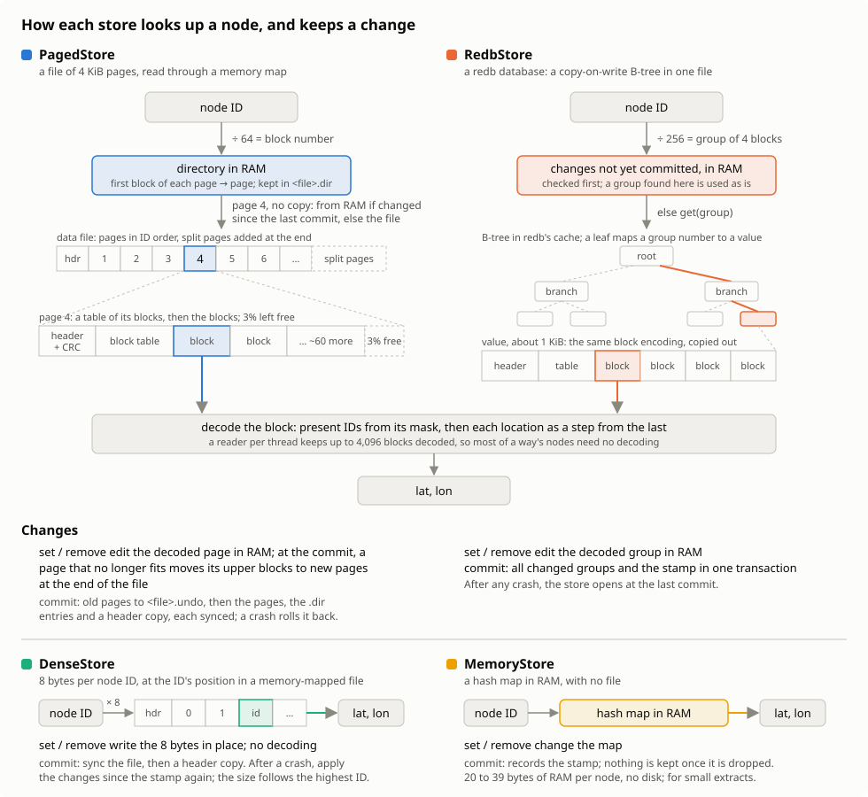
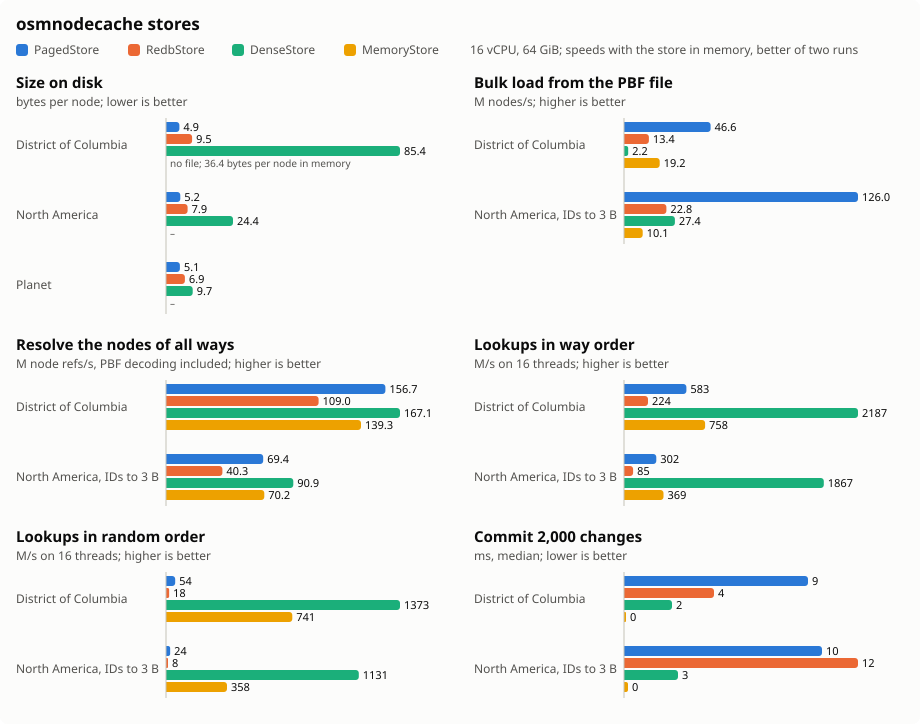

# osm-node-cache

[](https://github.com/nyurik/osm-node-cache)
[](https://crates.io/crates/osmnodecache)
[](https://crates.io/crates/osmnodecache)
[](https://docs.rs/osmnodecache)
[](https://github.com/nyurik/osm-node-cache/blob/main/LICENSE-APACHE)
[](https://github.com/nyurik/osm-node-cache/actions)
[](https://app.codecov.io/gh/nyurik/osm-node-cache)

A cache of OpenStreetMap node locations by node ID, for tools that read a PBF file's nodes first and then need their
locations to build ways: an importer, a renderer, a router. The cache can be built once from a planet file and kept up
to date with replication diffs, which move, delete and add nodes.

## Choosing a store

| Store                      | Feature            | Kept in                     | Planet  | Europe  | After a crash                                     |
|----------------------------|--------------------|-----------------------------|---------|---------|---------------------------------------------------|
| `PagedFileCache`           | `native` (default) | one memory-mapped file      | 55.1 GB | 15.9 GB | a killed process loses nothing; a power loss may  |
| `KvNodeStore<RedbBackend>` | `redb`             | a redb database file        | 62.7 GB | 17.8 GB | opens at the last commit, also after a power loss |
| `DenseFileCache`           | always             | a flat file, 8 bytes per ID |         | 81.4 GB | whatever the OS had written                       |
| `HashMapCache`             | always             | memory, saved to a file     |         |         | the last save                                     |

`PagedFileCache` is the fastest to build and to read, and the smallest for large areas. `KvNodeStore` looks nodes up at
about half the speed, for commits that are about 4.5 times faster and that a power loss cannot undo. Both implement the `NodeStore`, `NodeReader` and
`NodeBuilder` traits, so code written against them can switch between the two by changing a type. `DenseFileCache` and
`HashMapCache` are the original stores, with the `CacheStore` API.

## How the stores work

Both stores group node IDs into blocks of 64. A block keeps which of its IDs are present, and each location as the
step from the one before it, bit-packed or as varints, whichever is smaller; a location comes back exactly as the
PBF file has it, in 1e-7 degrees. A store finds a node's block, and a reader per thread keeps the last few blocks it
decoded, so most of a way's nodes need no decoding at all.



`PagedFileCache` packs the blocks into 4 KiB pages of one file, which it maps into memory, and keeps the first block
of each page in a directory in RAM (saved next to the file as `<file>.dir`). A lookup goes from the directory to the
page and from the page's table to the block, with no copy. A bulk load fills pages to 97%, so most later changes fit
in place; a page that overflows moves its upper blocks to a new page at the end of the file.

`KvNodeStore` keeps each group of 4 blocks (256 IDs) as one value in a key-value database. Changes are held in memory
until `commit`, which writes the changed groups and the stamp, such as the replication sequence number, in one
transaction. `KvBackend` is the trait a database implements; the `redb` feature adds `RedbBackend`.

## Using a store

```rust,no_run
use osmnodecache::{Location, PagedFileCache, PagedFileCacheOpts};

fn main() -> Result<(), Box<dyn std::error::Error>> {
    let opts = PagedFileCacheOpts::default();
    // bulk load in ascending ID order, as a sorted PBF file has them
    let mut builder = PagedFileCache::builder("nodes.cache", &opts)?;
    builder.push(1, Location::new(515_000_000, -1_000_000))?;
    builder.push(2, Location::new(515_000_100, -1_000_050))?;
    let mut cache = builder.finish()?;

    // reads take &self and can run on many threads; a reader per thread keeps recent blocks decoded
    let mut reader = cache.reader();
    assert_eq!(reader.get(2), Some(Location::new(515_000_100, -1_000_050)));

    // changes take &mut self
    cache.set(3, Location::new(515_000_200, -1_000_100))?;
    cache.remove(1)?;
    cache.flush()?;
    Ok(())
}
```

The same with redb, written against the traits:

```rust,ignore
use osmnodecache::{KvNodeStore, Location, NodeBuilder as _, NodeReader as _, NodeStore, RedbBackend};

fn main() -> Result<(), Box<dyn std::error::Error>> {
    type Store = KvNodeStore<RedbBackend>;
    let mut builder = Store::builder("nodes.redb".as_ref(), &Default::default())?;
    builder.push(1, Location::new(515_000_000, -1_000_000))?;
    let mut store = builder.finish(0)?;
    assert_eq!(store.reader().get(1), Some(Location::new(515_000_000, -1_000_000)));
    store.set(2, Location::new(515_000_100, -1_000_050))?;
    // keeps the change, and the replication sequence it came from, in one transaction
    store.commit(4_301_000)?;
    Ok(())
}
```

`DenseFileCache` stores each location as a `u64` at the position of its node ID, so the file takes 8 bytes for every
ID up to the highest one, and any thread can set any ID:

```rust,no_run
// This example uses osmpbf crate
use std::path::PathBuf;
use rayon::iter::{ParallelBridge, ParallelIterator};
use osmnodecache::{DenseFileCache, CacheStore as _};
use osmpbf::{BlobReader, BlobDecode};

fn main() {
  let reader = BlobReader::from_path("planet.osm.pbf").unwrap();
  let file_cache = DenseFileCache::new(PathBuf::from("node.cache")).unwrap();

  reader.par_bridge().for_each_with(
    file_cache,
    |fc, blob| {
      let mut cache = fc.get_accessor();
      if let BlobDecode::OsmData(block) = blob.unwrap().decode().unwrap() {
        for node in block.groups().flat_map(|g| g.dense_nodes()) {
          cache.set_lat_lon(node.id as usize, node.lat(), node.lon());
        }
      };
    });
}
```

## Performance



Measured with `examples/pbf_eval` on a laptop (Intel i9-10885H, 8 cores and 16 threads, 62 GB RAM, a solid-state disk), on
Geofabrik's District of Columbia (2026-10-27) and Europe (2022), and the planet (2026-10-19); redb had a 16 GiB cache.
Sizes are for the whole extracts. Speeds are for stores that fit in memory, the better of two runs: all of District of
Columbia, and the nodes of Europe up to ID 5,000,000,000 (10 GB). A store larger than the memory left free reads
pages from disk instead, so its speed depends on the machine more than on the store.

* **Lookups**: the native store is 2 to 2.8 times faster: in Europe, 49 against 23 million lookups a second in
  the order ways have their nodes, and 10.4 against 4.8 million in random order, on 16 threads. A lookup that finds
  its block among the reader's last few decoded ones takes no decoding at all; the native store then needs no copy
  either, while redb copies each value out of its B-tree.
* **Resolving every node of every way**, the PBF file's ways decoded on the same threads: 14.0 against 8.8 million
  node refs a second, so 2.8 against 4.4 minutes for the 2.35 billion refs to these nodes of Europe.
* **Building**: 23 against 14 million nodes a second.
* **Commits**: redb is 4 to 5 times faster, 18 against 81 ms for 2,000 edits, as `PagedFileCache::flush` syncs the
  whole mapping and rewrites the directory file; syncing only the changed pages is a planned change.
* **Size**: the native store is 10 to 12% smaller for Europe and the planet, and 50% larger for District of Columbia.
  A page's table numbers its blocks from the page's first one in 16 bits, so a page covers at most 4.2 million IDs,
  and an extract whose nodes are spread thinly over all IDs leaves most pages mostly empty.
* **Larger than memory**: resolving all of the planet's ways, with 55 to 63 GB stores and less memory free than
  that, took 27 minutes for the native store (8.0 million refs a second) and 41 for redb (5.4 million).

Whole extracts:

|  | Nodes | On disk | Bytes per node | Build | Build peak memory |
|---|---:|---:|---:|---:|---:|
| District of Columbia, native | 1,958,977 | 17 MB | 8.69 | 202 ms | 0.2 GB |
| District of Columbia, redb | 1,958,977 | 11 MB | 5.69 | 274 ms | 0.2 GB |
| Europe, native | 3,057,276,528 | 15.9 GB | 5.21 | 138 s | 16.3 GB |
| Europe, redb | 3,057,276,528 | 17.8 GB | 5.82 | 197 s | 19.8 GB |
| Planet, native | 10,949,467,954 | 55.1 GB | 5.03 | 412 s | 32.8 GB |
| Planet, redb | 10,949,467,954 | 62.7 GB | 5.73 | 10.3 min | 30.0 GB |

District of Columbia: 1,958,977 nodes, 2,507,044 way node refs. The better of two runs, and how far apart they were:

|  | native | redb |
|---|---:|---:|
| Build | 202 ms, 9.7 M nodes/s (±0%) | 248 ms, 7.9 M nodes/s (±10%) |
| Resolve all ways | 188 ms, 13.3 M refs/s (±7%) | 274 ms, 9.1 M refs/s (±5%) |
| Verify every node | 128 ms, 15 M nodes/s (±6%) | 152 ms, 13 M nodes/s (±6%) |
| Lookups in way order, 16 threads | 60.5 M/s (±23%) | 21.7 M/s (±6%) |
| Lookups in way order, 1 thread | 105 ns (±16%) | 261 ns (±11%) |
| Lookups in random order, 16 threads | 20.2 M/s (±11%) | 8.2 M/s (±9%) |
| Lookups in random order, 1 thread | 361 ns (±23%) | 899 ns (±6%) |
| Commit 2,000 edits, median | 37 ms (±1%) | 8 ms (±10%) |
| Commit 2,000 edits, 99th percentile | 45 ms (±3%) | 14 ms (±3%) |

Europe, the nodes up to ID 5,000,000,000: 1,840,399,735 nodes, 2,347,020,734 way node refs. The better of two runs, and how far apart they were:

|  | native | redb |
|---|---:|---:|
| Build | 79.9 s, 23.0 M nodes/s (±4%) | 134 s, 13.8 M nodes/s (±1%) |
| Resolve all ways | 168 s, 14.0 M refs/s (±5%) | 266 s, 8.8 M refs/s (±2%) |
| Verify every node | 59.7 s, 31 M nodes/s (±6%) | 77.3 s, 24 M nodes/s (±11%) |
| Lookups in way order, 16 threads | 49.2 M/s (±1%) | 23.2 M/s (±7%) |
| Lookups in way order, 1 thread | 174 ns (±8%) | 345 ns (±23%) |
| Lookups in random order, 16 threads | 10.4 M/s (±0%) | 4.8 M/s (±17%) |
| Lookups in random order, 1 thread | 1009 ns (±3%) | 2092 ns (±19%) |
| Commit 2,000 edits, median | 81 ms (±0%) | 18 ms (±26%) |
| Commit 2,000 edits, 99th percentile | 96 ms (±3%) | 26 ms (±34%) |

Peak memory counts the pages of a memory-mapped file that are in memory; the OS can drop them when it needs the room.

## Evaluating the stores

`examples/pbf_eval` measures ways of coding a PBF file's node locations, and builds, checks and times a store; a path
ending in `.redb` picks redb:

```sh
cargo run --release --example pbf_eval -- analyze europe-latest.osm.pbf
cargo run --release --example pbf_eval -- build europe-latest.osm.pbf europe.cache 0.97
cargo run --release --example pbf_eval -- verify europe-latest.osm.pbf europe.cache
cargo run --release --example pbf_eval -- bench europe-latest.osm.pbf europe.cache 10 300000 2000
cargo run --release --features redb --example pbf_eval -- build europe-latest.osm.pbf europe.redb
```

## Development

* This project is easier to develop with [just](https://github.com/casey/just#readme), a modern alternative to `make`.
  Install it with `cargo install just`.
* To get a list of available commands, run `just`.
* To run tests, use `just test`.

## License

Licensed under either of

* Apache License, Version 2.0 ([LICENSE-APACHE](LICENSE-APACHE) or <https://www.apache.org/licenses/LICENSE-2.0>)
* MIT license ([LICENSE-MIT](LICENSE-MIT) or <https://opensource.org/licenses/MIT>)
  at your option.

### Contribution

Unless you explicitly state otherwise, any contribution intentionally
submitted for inclusion in the work by you, as defined in the
Apache-2.0 license, shall be dual-licensed as above, without any
additional terms or conditions.
