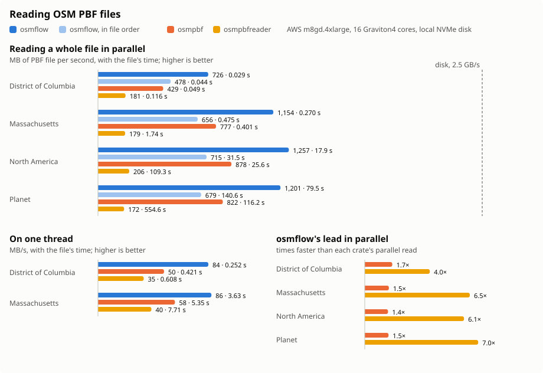

# osmflow

Fast, parallel reading of [OpenStreetMap](https://www.openstreetmap.org) PBF files, from a city extract to the planet.

```rust
use osmflow::{MemberType, PbfReader, Select};

fn read(path: &str) -> osmflow::Result<()> {
    let file = PbfReader::open(path)?;
    println!("written by {:?}", file.header().writing_program);

    // Every block on a pool of threads: the fastest way. Blocks come in no particular order within each run of one
    // object type, and a run starts only once every block before it is done, so in a sorted file every node is handled
    // before any way, and every way before any relation. The pool is shared by every reader and has two threads fewer
    // than the cores; `PbfReader::with_pool` gives a reader the caller's pool instead.
    file.par_unordered(Select::all(), |block| {
        // Nodes stored in plain and dense blocks come out the same way.
        for node in block.nodes() {
            let (id, lat, lon) = (node.id(), node.decimicro_lat(), node.decimicro_lon());
            for (key, value) in node.tags() { /* handle node tags */ }
            if let Some(info) = node.info() {
                let (version, user) = (info.version, info.user);
            }
        }
        for way in block.ways() {
            let (id, node_ids) = (way.id(), way.refs());
            for (key, value) in way.tags() { /* handle way tags */ }
        }
        for relation in block.relations() {
            for member in relation.members() {
                let is_way = member.kind == MemberType::Way;
                let (id, role) = (member.id, member.role);
            }
            for (key, value) in relation.tags() { /* handle relation tags */ }
        }
        Ok(())
    })?;

    // Blocks in file order, decoded ahead on a pool of threads and consumed on this one.
    for block in file.par_ordered(Select::node_locations())? {
        for node in block?.nodes() {
            let (_id, _lat, _lon) = (node.id(), node.decimicro_lat(), node.decimicro_lon());
        }
    }
    Ok(())
}
```

## How it reads

- **Protobuf through [`buffa`](https://crates.io/crates/buffa) views.** The blocks are decoded with a read projection
  of the format's schema (`proto/osmflow_raw.proto`) that declares only what osmflow reads, so the rest is skipped
  unread. Dense nodes are decoded only when nodes are selected, and only their locations when no tags or metadata
  are. Plain nodes, ways and relations are read by osmflow's own field reader, straight into columns. Packed arrays
  may be split into several fields or written unpacked, and message fields may arrive in several occurrences, which
  are merged, as the format allows.
- **Columns:** a block's objects are stored as columns of IDs, locations, references and string indexes. Its string
  table is checked as UTF-8 once and copied into one string, so a block keeps no decompressed buffer.
- **Selection:** [`Select`] skips the object types and fields a caller does not need.
- **Parallel:** one thread reads blobs; a pool decompresses and decodes them, and hands them out unordered (a
  callback on the pool, in any order within each run of one object type, with a barrier wherever the type changes)
  or ordered (an iterator on the caller's thread, in file order). Either way, the bytes in flight are bounded (16 MiB
  per pool thread, at least 256 MiB), so memory stays the same whatever the file's size.
- **Strict:** blob and header size limits, the declared uncompressed size, string indexes, array lengths and UTF-8 are
  all checked; an error names the blob and its byte offset.

The generated code in `src/generated` is checked in, so building needs no `protoc`. `just update-generated` regenerates
it with `examples/codegen.rs` (it needs `protoc`), and CI's `just codegen-check` fails if it is stale.

## Performance



Measured on an AWS m8gd.4xlarge (16 Graviton4 cores, 64 GiB of memory) with the PBF files on its local NVMe disk,
using District of Columbia (2026-10-27) and Massachusetts (2026-11-06) from Geofabrik, and North America and the planet
cut from the planet of 2026-10-19. Every reader reads every object, tag and member of the whole file, and all of them
read the same data; every read comes from the disk, not the page cache. osmflow decodes on its default pool of 14
threads; `osmpbf` 0.3.8 (with zlib-ng) and `osmpbfreader` 0.19.1 use rayon's global pool of 16.
[`benches/README.md`](benches/README.md) has what the benchmark measures, and how to run it.

| File | PBF size | Nodes | Ways | Relations | Way node refs | Tags |
|---|---:|---:|---:|---:|---:|---:|
| District of Columbia | 21 MB | 1,958,977 | 285,566 | 5,284 | 2,507,044 | 2,165,560 |
| Massachusetts | 312 MB | 37,868,785 | 4,163,209 | 38,056 | 44,049,684 | 14,924,497 |
| North America | 22.5 GB | 2,631,813,110 | 239,690,445 | 2,596,205 | 3,032,615,039 | 925,100,962 |
| Planet | 95.5 GB | 10,949,467,954 | 1,225,912,321 | 14,957,553 | 13,047,631,063 | 3,998,641,940 |

| Reader | District of Columbia | Massachusetts | North America | Planet |
|---|---:|---:|---:|---:|
| osmflow, `par_unordered` | 0.027 s, 779 MB/s | 0.231 s, 1,349 MB/s | 15.7 s, 1,434 MB/s | 71.7 s, 1,332 MB/s |
| osmflow, `par_ordered` | 0.038 s, 554 MB/s | 0.411 s, 758 MB/s | 26.0 s, 864 MB/s | 110.2 s, 866 MB/s |
| osmpbf, `par_map_reduce` | 0.050 s, 421 MB/s | 0.392 s, 795 MB/s | 25.2 s, 892 MB/s | 115.1 s, 830 MB/s |
| osmpbfreader, `par_iter` | 0.132 s, 159 MB/s | 2.06 s, 151 MB/s | 125.5 s, 179 MB/s * | 615.9 s, 155 MB/s * |
| osmflow, `blocks` | 0.226 s, 93 MB/s | 3.12 s, 100 MB/s |  |  |
| osmpbf, `ElementReader::for_each` | 0.411 s, 51 MB/s | 5.61 s, 56 MB/s |  |  |
| osmpbfreader, `iter` | 0.598 s, 35 MB/s | 7.73 s, 40 MB/s |  |  |

The disk reads 2.7 GB/s (10 GiB of the planet file with direct I/O).

\* `osmpbfreader`'s parallel reads of North America and the planet take 2 and 10 minutes, so they come from an earlier
run of the same benchmark, with North America in the page cache; at under 200 MB/s, it is far from the disk's limit.
Every other time is from one run.

* **osmflow reads 1.6 to 1.9 times as fast as `osmpbf` in parallel, and 1.8 times as fast on one thread;** in parallel
  it is 5 to 9 times as fast as `osmpbfreader`.
* **The reads are bound by the CPU, not the disk:** osmflow reads the planet at about half the disk's speed.
* **`par_unordered` keeps object types apart at almost no cost:** with its barriers between runs of one type, every
  node of a sorted file is handled before any way, and every way before any relation, for under 0.4% of the planet's
  read time.
* **`par_ordered` hands out blocks in file order** on the caller's thread, which is the limit when the consumer does
  much per block, as this benchmark's does.
