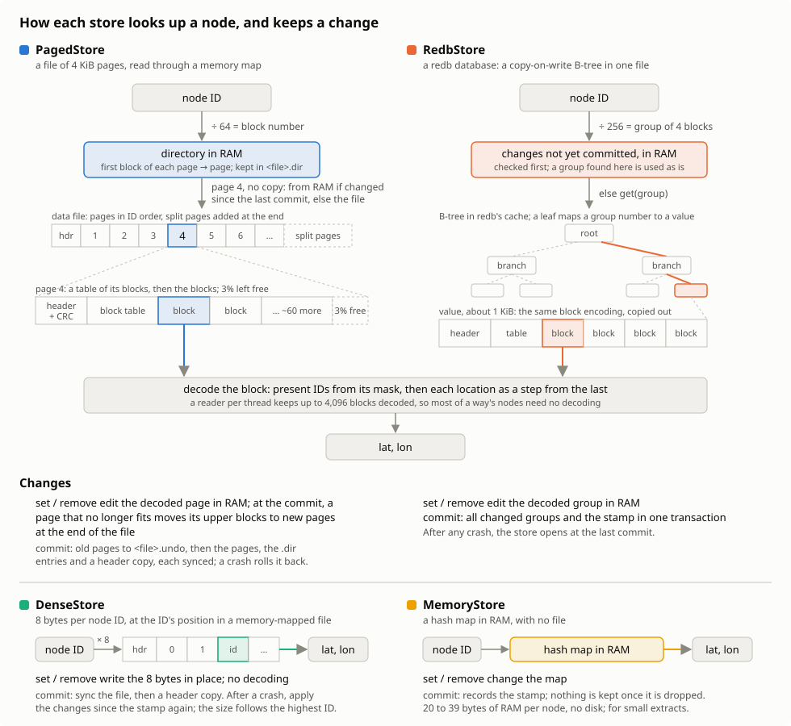
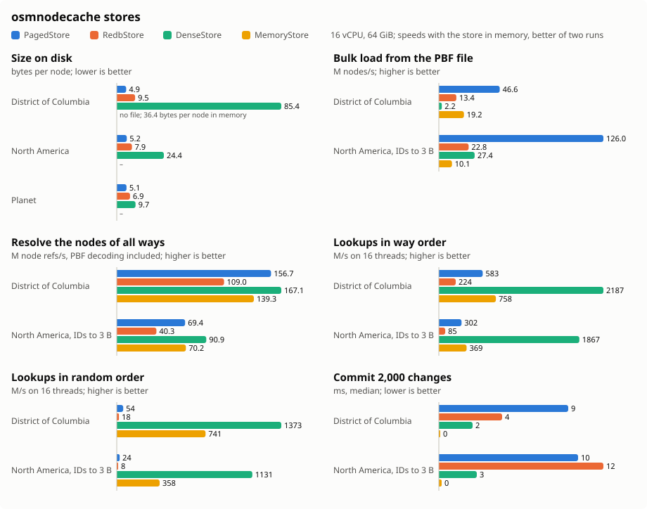

# osmnodecache

[](https://github.com/nyurik/osm-node-cache)
[](https://crates.io/crates/osmnodecache)
[](https://crates.io/crates/osmnodecache)
[](https://docs.rs/osmnodecache)
[](https://github.com/nyurik/osm-node-cache/blob/main/LICENSE-APACHE)
[](https://github.com/nyurik/osm-node-cache/actions)
[](https://app.codecov.io/gh/nyurik/osm-node-cache)

A store of OpenStreetMap node locations by node ID, for tools that read a PBF file's nodes first and then need their
locations to build ways: an importer, a renderer, a router. A store is loaded once from a planet file or an extract, and
then kept up to date with replication diffs, which move, delete and add nodes.

## Choosing a store

Four stores, each behind its own feature, implement the same traits, so code written against them switches stores by
changing a type. They trade lookup speed, size, and the cost and safety of changes differently:

| Store         | Feature           | Kept in                                             | Disk size, North America / planet                                                                                                 | Lookups in random order | Commit 2,000 changes | After a crash                              |
|---------------|-------------------|-----------------------------------------------------|-----------------------------------------------------------------------------------------------------------------------------------|-------------------------|----------------------|--------------------------------------------|
| `PagedStore`  | `paged` (default) | 4 KiB pages of delta-coded blocks, memory-mapped    | 13.7 GB / 55.6 GB: about 5 bytes per node                                                                                         | 24 M/s                  | 10 ms                | the last commit, also after a power loss   |
| `RedbStore`   | `redb`            | the same blocks, 4 per value in a redb B-tree       | 20.7 GB / 75.7 GB: about 7 to 8 bytes per node                                                                                    | 8.0 M/s                 | 12 ms                | the last commit, also after a power loss   |
| `DenseStore`  | `dense`           | 8 bytes per ID, at the ID's position, memory-mapped | 64.3 GB / 106.7 GB: a sparse file of 8 bytes × the highest node ID; its holes, the ID ranges with no nodes, may use no disk space | 1,131 M/s               | 3 ms                 | the last commit, and some changes after it |
| `MemoryStore` | `memory`          | a hash map in RAM, with no file                     | none; 20 to 39 bytes per node of RAM instead                                                                                      | 358 M/s                 | none needed          | nothing: it has no file                    |

The disk sizes are of whole extracts. The lookups and commits were measured on a local NVMe disk, with each store in
memory, on North America's nodes up to ID 3 billion; the [performance](#performance) section has the details.

* `PagedStore`, the default, is the smallest for large data and the fastest to load: the planet in 69 s, into 55.6 GB.
  Its lookups are fast as long as its file, about 5 bytes per node, fits in memory, which makes it the only store that
  resolves the planet's ways on a 64 GiB host at memory speed: 57 s, once the store is in memory.
* `DenseStore` has by far the fastest lookups, one memory read each, but its file is huge: 8 bytes for every ID up to
  the highest one stored, 107 GB for the planet. Extracts have nodes with IDs all the way up, so their files are as
  long; the parts with no nodes take no disk space on most file systems, but an extract still takes far more than in
  the other stores: 64.3 GB for North America, 167 MB (85 bytes per node) for District of Columbia. It is only fast
  with memory for the whole file.
* `RedbStore` puts the nodes in [redb](https://crates.io/crates/redb), a well-tested database, at the cost of slower
  lookups and loads, and a larger file.
* `MemoryStore` keeps the nodes in a hash map in RAM, and has no file: it takes no disk space, and nothing is left of it
  when the process ends. It takes the most memory, 20 to 39 bytes per node depending on how full its hash map is (the
  planet's 11 billion nodes would take about 290 GB), and is the fastest to change: a change is one hash map update,
  and a commit only records the stamp. It suits a city or a region, which loads from its PBF file in a second or two.

All stores:

* take node IDs up to `MAX_NODE_ID` (about 68.7 billion) and locations in 1e-7 degrees, as PBF files have them, and give
  them back exactly;
* bulk load from nodes in ascending ID order, much faster than setting them one by one;
* keep a stamp, such as the replication sequence number, and up to 1 KiB of named metadata values, committed with the
  nodes.

The three stores kept in a file (all but `MemoryStore`) also:

* lock their files, so one process changes a store, and any number read it while no one changes it;
* open in one of three ways: to read only, which has no methods that change the store; to read and write, creating the
  store if it is missing; and to read, write and repair what can be repaired of a damaged store;
* keep checkpoints during a bulk load, so a load cut short by a crash resumes: it is fed the same nodes from the start,
  checks those it kept, and goes on.

## How the stores work



`PagedStore` and `RedbStore` group node IDs into blocks of 64. A block keeps which of its IDs are present, and each
location as the step from the one before it, bit-packed or as varints, whichever is smaller. A reader per thread keeps
up to 4,096 blocks it decoded (2 MiB), block `n` in slot `n % 4096`, so most of a way's nodes need no decoding at
all.

`PagedStore` packs the blocks into 4 KiB pages of one file, read through a memory map, with a CRC-32 per page. A
directory of the first block of each page is kept in memory, and in `<file>.dir`, to which pages are only ever added. A
bulk load encodes the blocks on all cores, fills pages to 97%, so most later changes fit in place, and writes them
1 MiB at a time; every 1 GiB, it keeps a checkpoint on another thread while it goes on loading. Until a commit, changed pages wait decoded in memory.
A commit encodes them on all cores, moving the blocks of a page that overflows to new pages at the end of the file,
filled as a bulk load fills them. It saves the old contents of the pages it changes to `<file>.undo`, writes the new
ones and the new directory entries, then a header with the stamp and metadata, syncing each in turn; the header has two
copies, written in turn. Opening the store after a crash during a commit rolls it back.

`RedbStore` keeps each group of 4 blocks (256 IDs) as one value in a [redb](https://crates.io/crates/redb) database, a
copy-on-write B-tree. Changes wait in memory until a commit writes them, the stamp and the metadata in one transaction.
A bulk load encodes the groups on all cores, and inserts them in order. `KvStore` and the `KvBackend` trait it uses can
hold the same groups in another key-value database.

`DenseStore` keeps 8 bytes per node ID, at the ID's position in a memory-mapped file, so a lookup is one memory read
and a change one write. The file takes 8 bytes times the highest ID in it, whatever the number of nodes: over 100 GB
for the planet, and as much for an extract, although unwritten parts of it take no disk space on most file systems. A
bulk load writes the values of a million IDs at a time, not through the memory map, and keeps its checkpoints on
another thread.
Changes are written in place, so after a crash the store may have some of the changes since its last commit; applying
the changes since its stamp again makes it right.

`MemoryStore` keeps a hash map in memory from node ID to location, 16 bytes and a control byte per slot of the map, with
at most 7 of 8 slots filled. It has no file: changes take effect when they are made, and a commit only records the
stamp.

## Using a store

```rust
use osmnodecache::prelude::*;
use osmnodecache::{Location, PagedStore};

fn load_and_update() -> Result<(), Box<dyn std::error::Error>> {
    // opens the store to read and write, creating it if it is missing
    let mut store = PagedStore::open("nodes.cache")?;

    // a bulk load in ascending ID order, as a sorted PBF file has them; after a crash, the same
    // load run again checks the nodes the store kept, up to `resume_after()`, and goes on
    let mut load = store.bulk_load()?;
    load.push(1, Location::new(515_000_000, -1_000_000))?;
    load.push(2, Location::new(515_000_100, -1_000_050))?;
    load.finish(0)?;

    // reads; a reader per thread keeps up to 4,096 blocks it read decoded
    let mut reader = store.reader();
    assert_eq!(reader.get(2), Some(Location::new(515_000_100, -1_000_050)));

    // a replication diff, kept with its sequence number and metadata at the commit
    store.set(3, Location::new(515_000_200, -1_000_100))?;
    store.remove(1)?;
    store.set_metadata("replication_url", b"https://planet.openstreetmap.org/replication/minute")?;
    store.commit(4_301_000)?;
    Ok(())
}
```

The stores kept in a file open with the `FileStore` trait's functions. A store opened to read only is a
`PagedStore<ReadOnly>`, which has no methods that change it. Opening checks the header and the directory, but not the
pages, which would read the whole file: a damaged page shows only when it is read, as wrong locations or a panic.
Opening with `open_and_fix` also reads every page, for a store that may be damaged, as after a disk error. It rebuilds a
lost directory file, and drops pages whose CRC is wrong, reporting the node IDs they held:

```rust
use osmnodecache::prelude::*;
use osmnodecache::PagedStore;

fn check_and_fix() -> Result<(), Box<dyn std::error::Error>> {
    let store = PagedStore::open_read_only("nodes.cache")?;
    println!("nodes as of replication sequence {}", store.stamp());
    drop(store);
    let (_store, report) = PagedStore::open_and_fix("nodes.cache")?;
    for ids in report.lost {
        println!("lost the nodes from {} to {}", ids.start(), ids.end());
    }
    Ok(())
}
```

A memory store, which has no file, is made with `MemoryStore::new()`. Code written against the traits works with any
store:

```rust
use osmnodecache::prelude::*;
use osmnodecache::Location;

/// The locations of a way's nodes, leaving out those the store does not have.
fn way_geometry(store: &impl NodeRead, refs: &[u64]) -> Vec<Location> {
    let mut reader = store.reader();
    refs.iter().filter_map(|&id| reader.get(id)).collect()
}
```

### Importing the planet fast

What made the most difference for the planet, in the [performance](#performance) runs:

* **Read the PBF file in big reads, with direct I/O** (`O_DIRECT` on Linux). Through the page cache, the OS reads ahead
  only 128 KiB at a time by default, which on a network disk keeps too few reads in flight. Direct reads also keep the
  95 GB file from pushing the store out of memory.
* **Decode only what the store needs** from the PBF file: node IDs and locations, and way refs. The `osmpbf` crate
  decodes all of each block; `examples/pbf_eval` has a decoder of just those fields.
* **Push nodes in batches** of a million or so with `BulkLoad::push_batch`: the paged and redb stores check and encode
  big batches on all cores.
* **Keep one reader per thread** (`NodeRead::reader`) for all of a thread's lookups: it keeps up to 4,096 decoded blocks
  (2 MiB), and making one has a cost.
* **Read the store into memory before resolving**, if it fits but is not there, as after a restart: `NodeRead::preload`
  reads it in big reads on all cores, 27.5 s for the planet's 55.6 GB `PagedStore`. Preload right after a load too:
  the OS may have dropped parts of the store from memory, and reading them back a page at a time, on first use, is much
  slower.
* **Give the memory back after the load.** glibc's allocator can keep much of the memory that the PBF decoding freed,
  which leaves too little for the store; `malloc_trim(0)` returns it to the OS.

## Performance



Measured with `examples/pbf_eval/measure.sh` on an AWS m8gd.4xlarge (16 Graviton4 cores, 64 GiB of memory), with the
PBF files and the stores on its local 885 GB NVMe disk, using District of Columbia from Geofabrik (2026-10-27), and
North America and the planet cut from the planet of 2026-10-19. Whole extracts were read with direct I/O. Lookups and
commits were measured with each store in memory: District of Columbia, and the nodes of North America up to ID 3 billion
(14 GB as a dense store), each run twice, the better run shown. An instance's local disk is lost when the instance
stops, so it suits a store that can be rebuilt, with the PBF file kept elsewhere and copied to it first.

### The planet

10.9 billion nodes, and 1.23 billion ways with 13.0 billion node refs:

|                                                             | `PagedStore`                                 | `RedbStore`        | `DenseStore`       |
|-------------------------------------------------------------|----------------------------------------------|--------------------|--------------------|
| On disk                                                     | 55.6 GB, 5.08 bytes per node                 | 75.7 GB, 6.91      | 106.7 GB, 9.74     |
| Bulk load from the PBF file                                 | 69 s                                         | 349 s              | 119 s              |
| Resolve all ways, with none of the store in memory at first | 84 s: 27.5 s to read the store in, then 57 s | larger than memory | larger than memory |

* **Importing the planet** with the paged store, from the PBF file to every way's node locations, takes 2.5 minutes.
* **The paged load is bound by the store, not the disk**: 59 s of its 69 s are spent encoding and writing it. The
  redb load is bound by its encoding, and the dense store writes the most, 107 GB, as the planet's node IDs leave few
  gaps.
* **Only the paged store fits in the host's memory**, so only it resolves the planet's ways at memory speed: 231
  million refs a second once it is in memory, 49 ns per lookup on each of 16 threads.

### What made it faster

Since the first runs of these stores, which read the PBF file with the [`osmpbf`](https://crates.io/crates/osmpbf)
crate:

* the PBF file is read with direct I/O, and decoded for just the needed fields, decompressed with zlib-rs;
* the store is read into memory before resolving, and the PBF file kept out of the page cache;
* a reader keeps 4,096 decoded blocks instead of 4, direct-mapped and allocated zeroed, so a new reader costs next to
  nothing;
* the paged and redb stores check and encode batches on all cores, and keep their load checkpoints on another thread;
* the dense store writes values a million IDs at a time, writes changes to the file instead of through its memory map,
  and leaves the gaps between IDs as holes.

Some findings along the way:

* **Writing a memory-mapped file that the page cache holds in large folios** (XFS does, for big writes) dirties whole
  folios, so a dense store commit after a bulk load wrote far more than it changed. The dense store now writes changes
  to the file, and maps it only to read.
* **Writing past the end of a file on XFS** has it keep blocks after it, which take disk space once the file grows past
  them: the dense store grows its file first, as it did through the memory map.
* **Not worth it**: more blocks per redb value made the file a little smaller and loads much slower; more groups per
  redb transaction loaded no faster; compacting the redb file after a load saved nothing; entropy coding (rANS) would
  make the paged store a little smaller and its lookups slower.

### Async

An async API would not make these stores faster. Loading is limited by encoding and the disk, and the checkpoints are
already made durable on another thread. With the store in memory, a lookup takes tens of nanoseconds, much less than an
async task switch. With a store larger than memory, the disk's random reads are the limit. It would let an async
program look up nodes without blocking its runtime's threads on the disk, as a reader with positioned reads could,
trying the page cache first (`preadv2` with `RWF_NOWAIT`), instead of a memory map; that is worth adding when such a
program needs it.

Whole extracts:

|  | Nodes | On disk | Bytes per node | Bulk load | Load peak memory | Resolve all ways |
|---|---:|---:|---:|---:|---:|---:|
| District of Columbia, `PagedStore` | 1,958,977 | 10 MB | 4.90 | 42 ms | 0.1 GB |  |
| District of Columbia, `RedbStore` | 1,958,977 | 19 MB | 9.51 | 146 ms | 0.1 GB |  |
| District of Columbia, `DenseStore` | 1,958,977 | 167 MB | 85.35 | 871 ms | 0.2 GB |  |
| District of Columbia, `MemoryStore` | 1,958,977 | none (71 MB in memory) | 36.40 in memory | 102 ms | 0.1 GB |  |
| North America, `PagedStore` | 2,631,813,110 | 13.7 GB | 5.20 | 17.2 s | 0.6 GB |  |
| North America, `RedbStore` | 2,631,813,110 | 20.7 GB | 7.88 | 101 s | 18.5 GB |  |
| North America, `DenseStore` | 2,631,813,110 | 64.3 GB | 24.43 | 141 s | 0.7 GB |  |
| Planet, `PagedStore` | 10,949,467,954 | 55.6 GB | 5.08 | 68.7 s | 15.5 GB | 84.1 s, 155.1 M refs/s (27.5 s of it reading the store into memory) |
| Planet, `RedbStore` | 10,949,467,954 | 75.7 GB | 6.91 | 349 s | 33.7 GB |  |
| Planet, `DenseStore` | 10,949,467,954 | 106.7 GB | 9.74 | 119 s | 15.3 GB |  |

District of Columbia: 1,958,977 nodes, 2,507,044 way node refs. The better of two runs, and how far apart they were:

|  | `PagedStore` | `RedbStore` | `DenseStore` | `MemoryStore` |
|---|---:|---:|---:|---:|
| Bulk load | 42 ms, 46.6 M/s (±31%) | 146 ms, 13.4 M/s (±6%) | 871 ms, 2.2 M/s (±1%) | 102 ms, 19.2 M/s (±6%) |
| Resolve all ways | 16 ms, 156.7 M/s (±12%) | 23 ms, 109.0 M/s (±4%) | 15 ms, 167.1 M/s (±7%) | 18 ms, 139.3 M/s (±6%) |
| Verify every node | 44 ms, 45 M/s (±9%) | 58 ms, 34 M/s (±3%) | 44 ms, 45 M/s (±14%) | 137 ms, 14 M/s (±4%) |
| Lookups in way order, 16 threads | 583.3 M/s (±16%) | 224.2 M/s (±1%) | 2186.9 M/s (±8%) | 757.6 M/s (±2%) |
| Lookups in way order, 1 thread | 20 ns (±10%) | 39 ns (±0%) | 12 ns (±0%) | 17 ns (±6%) |
| Lookups in random order, 16 threads | 53.8 M/s (±4%) | 18.2 M/s (±1%) | 1372.8 M/s (±1%) | 741.0 M/s (±3%) |
| Lookups in random order, 1 thread | 256 ns (±18%) | 528 ns (±11%) | 10 ns (±0%) | 17 ns (±6%) |
| Commit 2,000 changes, median | 9 ms (±3%) | 4 ms (±0%) | 2 ms (±0%) | 0 ms (±0%) |
| Commit 2,000 changes, 99th percentile | 13 ms (±5%) | 6 ms (±3%) | 4 ms (±15%) | 0 ms (±0%) |

North America, the nodes up to ID 3,000,000,000: 618,849,582 nodes, 706,551,105 way node refs. The better of two runs, and how far apart they were:

|  | `PagedStore` | `RedbStore` | `DenseStore` | `MemoryStore` |
|---|---:|---:|---:|---:|
| Bulk load | 4.9 s, 126.0 M/s (±12%) | 27.1 s, 22.8 M/s (±11%) | 22.6 s, 27.4 M/s (±0%) | 61.5 s, 10.1 M/s (±3%) |
| Resolve all ways | 10.2 s, 69.4 M/s (±46%) | 17.5 s, 40.3 M/s (±1%) | 7.8 s, 90.9 M/s (±0%) | 10.1 s, 70.2 M/s (±1%) |
| Verify every node | 8.4 s, 74 M/s (±0%) | 12.9 s, 48 M/s (±1%) | 4.2 s, 148 M/s (±0%) | 78.2 s, 8 M/s (±0%) |
| Lookups in way order, 16 threads | 301.6 M/s (±2%) | 84.8 M/s (±7%) | 1867.0 M/s (±2%) | 369.1 M/s (±9%) |
| Lookups in way order, 1 thread | 31 ns (±0%) | 63 ns (±0%) | 12 ns (±0%) | 48 ns (±6%) |
| Lookups in random order, 16 threads | 24.2 M/s (±1%) | 8.0 M/s (±1%) | 1131.3 M/s (±2%) | 357.7 M/s (±4%) |
| Lookups in random order, 1 thread | 805 ns (±1%) | 1878 ns (±2%) | 16 ns (±0%) | 47 ns (±4%) |
| Commit 2,000 changes, median | 10 ms (±5%) | 12 ms (±3%) | 3 ms (±4%) | 0 ms (±0%) |
| Commit 2,000 changes, 99th percentile | 15 ms (±57%) | 16 ms (±86%) | 4 ms (±11%) | 0 ms (±0%) |

"Load peak memory" counts the pages of a memory-mapped file that were in memory; the OS drops them when it needs room.


## Evaluating the stores

`examples/pbf_eval` builds, checks and times a store from a PBF file; a path ending in `.redb` or `.dense` picks that
store, and any other the paged one. A path ending in `.mem` picks the memory store, which has no file, so each command
loads it from the PBF file again. It reads PBF files with its own decoder of just node IDs, locations and way refs, on
all cores; `decode` times reading, decompressing and decoding a file with no store, and compares with `osmpbf`.
`examples/pbf_eval/measure.sh` runs it on a small extract, a large one and the planet, and
`examples/pbf_eval/report.py` makes the chart and tables above from the logs. `just bench` times lookups and
commits of every store on synthetic nodes.

```sh
# build a store, then time resolving the nodes of all ways with it
cargo run --release --all-features --example pbf_eval -- build europe-latest.osm.pbf europe.cache
# check that the store has exactly the file's nodes
cargo run --release --all-features --example pbf_eval -- verify europe-latest.osm.pbf europe.cache
# time lookups of the ways' nodes, then 300,000 changes committed 2,000 at a time
cargo run --release --all-features --example pbf_eval -- bench europe-latest.osm.pbf europe.cache 10 300000 2000
# the same with nodes up to ID 3 billion only, so the store fits in memory
cargo run --release --all-features --example pbf_eval -- --max-id 3000000000 build europe-latest.osm.pbf europe.redb
# the planet: read it with direct I/O, and the store into memory before resolving
cargo run --release --all-features --example pbf_eval -- --direct --preload build planet.osm.pbf planet.cache
# the parts of reading a PBF file, with no store
cargo run --release --all-features --example pbf_eval -- --direct decode planet.osm.pbf
```

## License

Licensed under either of

* Apache License, Version 2.0 ([LICENSE-APACHE](../../LICENSE-APACHE) or <https://www.apache.org/licenses/LICENSE-2.0>)
* MIT license ([LICENSE-MIT](../../LICENSE-MIT) or <https://opensource.org/licenses/MIT>)
  at your option.

### Contribution

Unless you explicitly state otherwise, any contribution intentionally
submitted for inclusion in the work by you, as defined in the
Apache-2.0 license, shall be dual-licensed as above, without any
additional terms or conditions.
